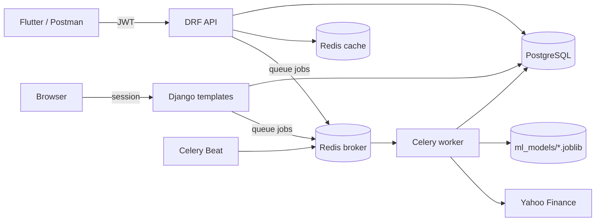

# Stock Portfolio Risk & Forecasting Platform


A Django REST Framework backend and web app where investors track stock portfolios and every holding gets two machine-learning predictions:

- a **risk label** (low / medium / high) from a **Random Forest**, checked against a **Logistic Regression** baseline
- a **next-trading-day direction** (up / down) from **Gradient Boosting**, checked against simple baselines

Admins upload the price dataset and train the models from the browser. A JSON API with JWT authentication serves mobile clients such as Flutter.

**Author:** Dion James Smith

---

## Contents

- [Features](#features)
- [Tech stack](#tech-stack)
- [Architecture](#architecture)
- [Roles](#roles)
- [Getting started](#getting-started)
- [Creating investors, analysts and admins](#creating-investors-analysts-and-admins)
- [Uploading data and training models](#uploading-data-and-training-models)
- [API](#api)
- [Machine learning](#machine-learning)
- [Background tasks](#background-tasks)
- [Caching and security](#caching-and-security)
- [Project structure](#project-structure)
- [Postman collection](#postman-collection)
- [Logging](#logging)
- [Roadmap](#roadmap)
- [Disclaimer](#disclaimer)

---

## Features

**Portfolios**
- Investors create portfolios and add holdings (ticker, quantity, buy price, buy date)
- Portfolio summary: total cost, current value, unrealised gain/loss and risk distribution
- Price chart and history for every holding

**Machine learning**
- Risk label and direction forecast for every holding, with confidence scores and the model version that produced them
- Admin pages to upload data, train models, follow progress and compare every saved model version
- Weekly automatic retraining and nightly prediction updates

**Market data**
- Upload the Kaggle S&P 500 dataset as CSV files, a whole folder, or the original `.zip`
- Daily price updates from Yahoo Finance

**Platform**
- Three roles (investor, analyst, admin), with data scoped to each role
- JWT authentication built with PyJWT: refresh tokens, logout blacklist, tokens invalidated on password change
- Same `status` / `message` / `data` / `errors` shape for every API response
- Redis caching, rate limiting, Celery workers and Celery Beat schedules
- Role-specific dashboards in both the API and the web interface

## Tech stack

| Area | Used |
|---|---|
| Backend | Django 6.1, Django REST Framework 3.18 (function-based views) |
| Database | PostgreSQL (psycopg 3) |
| Authentication | Custom `User` model, JWT with PyJWT |
| Background jobs | Celery 5.6 + Celery Beat, Redis broker |
| Cache, throttling, token blacklist | Redis |
| Machine learning | pandas, NumPy, scikit-learn, joblib |
| Market data | Kaggle CSV dataset, yfinance |
| Web interface | Django templates, Bootstrap 5, Chart.js |

## Architecture



| App | Responsibility |
|---|---|
| `accounts` | Custom user, registration, login, JWT tokens, profile, password change, role management |
| `core` | Shared code: logger, decorators, API response helper, permissions, pagination, exception handler, throttles, cache keys, upload field |
| `market_data` | Price history, dataset upload pages and import task, Yahoo Finance updates, price APIs |
| `portfolios` | Portfolios and holdings, CRUD APIs, portfolio summary |
| `ml_training` | All training code: the three algorithms, features, labels, data split, model registry, training runs and pages |
| `analytics` | Uses the trained models: prediction tasks, risk and forecast APIs, portfolio risk summary |
| `dashboards` | Investor, analyst and admin dashboards, holding trend, portfolio and holding pages |

Forms (`ModelForm`) validate input. DRF serializers are used only for output.

## Roles

| Role | Can do |
|---|---|
| **Investor** | Manage their own portfolios and holdings; see prices, predictions and their own dashboard |
| **Analyst** | Read-only access to the portfolios of investors assigned to them; can queue price refreshes and prediction recomputes |
| **Admin** | Everything: all portfolios, user roles and analyst assignment, dataset uploads, model training |

A record a user is not allowed to see returns **404**. A record they can see but not change returns **403**.

## Getting started

### Requirements

- Python 3.12+
- PostgreSQL
- Redis

### Install

```bash
git clone <your-repo-url>
cd stock_risk_engine
python -m venv venv
source venv/bin/activate          # Windows: venv\Scripts\activate
pip install -r requirements.txt
cp .env.example .env
```

Fill in `.env`. Generate three **different** secrets for `SECRET_KEY`, `JWT_SECRET_KEY` and `JWT_REFRESH_SECRET_KEY`:

```bash
python -c "import secrets; print(secrets.token_urlsafe(64))"
```

Create the database:

```sql
CREATE USER django_user WITH PASSWORD 'your-password';
CREATE DATABASE stock_risk_prediction_db OWNER django_user;
```

Apply migrations and create the first admin:

```bash
python manage.py migrate
python manage.py createsuperuser
```

### Run

Start each service in its own terminal from the project folder:

```bash
redis-server
python manage.py runserver
celery -A stock_risk_engine worker -l info
celery -A stock_risk_engine beat -l info
```

On Windows, start the worker with `--pool=solo`.

Open http://127.0.0.1:8000 and log in as the admin.

### Environment variables

| Variable | Purpose | Example |
|---|---|---|
| `DB_NAME`, `DB_USER`, `DB_PASSWORD`, `DB_HOST`, `DB_PORT` | PostgreSQL connection | `stock_risk_prediction_db` |
| `SECRET_KEY` | Django secret | random |
| `JWT_SECRET_KEY`, `JWT_REFRESH_SECRET_KEY` | Separate secrets for access and refresh tokens | random |
| `ACCESS_TOKEN_LIFETIME_MINUTES`, `REFRESH_TOKEN_LIFETIME_DAYS` | Token lifetimes | `15`, `7` |
| `CELERY_BROKER_URL` | Celery broker | `redis://localhost:6379/0` |
| `CELERY_RESULT_BACKEND` | Celery results | `redis://localhost:6379/1` |
| `REDIS_URL` | Django cache and throttles | `redis://localhost:6379/2` |
| `TOKEN_BLACKLIST_REDIS_URL` | Logged-out refresh tokens | `redis://localhost:6379/3` |
| `CACHE_TTL_SECONDS` | Summary cache lifetime | `300` |
| `LOGIN_THROTTLE_RATE`, `REGISTER_THROTTLE_RATE`, `MARKET_REFRESH_THROTTLE_RATE` | Rate limits | `5/minute`, `10/hour`, `10/hour` |
| `MARKET_SEED_TICKERS` | Tickers always included in daily price updates | `AAPL,MSFT` |

The four Redis URLs must be different. Settings refuse to start otherwise, so clearing the cache can never delete queued tasks or logged-out tokens.

## Creating investors, analysts and admins

Public registration **always creates an investor**. Nobody can choose their own role, so a stranger can never sign up as an analyst or admin. If a `role` field is sent, it is ignored.

| Role | How the account is created |
|---|---|
| Investor | `POST /api/accounts/register/` or the **Register** page |
| Analyst | Register normally, then an admin changes the role to `analyst` |
| Admin | `python manage.py createsuperuser`, or an admin changes the role to `admin` |

### 1. Register an investor

`POST /api/accounts/register/` (no token needed)

```json
{
    "username": "dion_investor",
    "email": "dion.investor@example.com",
    "password": "Investor-Pass-2026!",
    "password_confirmation": "Investor-Pass-2026!"
}
```

Response `201 Created`:

```json
{
    "status": "success",
    "message": "Investor account created successfully.",
    "data": {
        "id": 2,
        "username": "dion_investor",
        "email": "dion.investor@example.com",
        "role": "investor",
        "assigned_analyst": null,
        "is_active": true,
        "date_joined": "2026-11-07T08:30:00Z",
        "updated_at": "2026-11-07T08:30:00Z"
    },
    "errors": null
}
```

### 2. Register the future analyst

Same endpoint and body shape. The account starts as an investor:

```json
{
    "username": "riya_analyst",
    "email": "riya.analyst@example.com",
    "password": "Analyst-Pass-2026!",
    "password_confirmation": "Analyst-Pass-2026!"
}
```

### 3. Admin promotes them to analyst

Log in as the admin (`POST /api/accounts/login/` with `username_or_email` and `password`), then send the admin's access token:

`PATCH /api/accounts/users/{analyst_user_id}/`
`Authorization: Bearer <admin access token>`

```json
{
    "role": "analyst"
}
```

The response shows `"role": "analyst"`. The same change can be made on the **Users** page in the web interface.

### 4. Admin assigns the analyst to an investor

`PATCH /api/accounts/users/{investor_user_id}/`

```json
{
    "assigned_analyst": 3
}
```

The analyst can now read that investor's portfolios, holdings and predictions, but cannot change them.

Rules:
- `assigned_analyst` must be an active analyst, and only investors can have one.
- An admin cannot change their own role.
- If an analyst is changed to another role, all of their investors are unassigned.

## Uploading data and training models

Everything is done in the browser while logged in as an admin. The Celery worker must be running, because uploads and training run in the background.

### 1. Upload the dataset — **Datasets** page (`/datasets/`)

The model data comes from the Kaggle dataset *S&P 500 Stocks, Daily Historical Data (10 Years)*. It has one CSV per ticker (for example `AAPL.csv`) with `Date, Open, High, Low, Close` and an optional `Volume` column. You can upload:

- several CSV files,
- a whole folder (other files in it, such as `.DS_Store`, are ignored), or
- the Kaggle `.zip` exactly as downloaded.

You can also limit the upload to certain tickers. While the upload runs, a progress bar shows how many files are done and refreshes on its own. When it finishes, every file is listed with rows added and skipped, or the reason it failed. Rows that already exist are skipped, so uploading the same files again is safe.

**Fetch now** downloads any missing recent prices from Yahoo Finance. This also runs every weekday automatically.

### 2. Train — **ML Training** page (`/ml/`)

1. Check the **Training data** card: it shows whether the prices cover 2022 or earlier, 2023, and 2024 onwards. Training is disabled until all three are covered.
2. Choose both models, the risk model only, or the forecast model only. Optionally limit the tickers, and choose whether to update every holding's prediction when training finishes.
3. Click **Start training**. The run page shows the current step and refreshes on its own. When training finishes, it shows each model's test results next to its baselines.

Only one training run can be active at a time. A run that is still waiting for a worker can be cancelled.

### 3. Review — **Model versions** (`/ml/models/`)

Every trained model is kept. Each version's page shows its date split, label thresholds, baseline comparison, per-class scores, confusion matrix, feature importance and parameters. The newest version of each type is the one used for predictions.

## API

Base URL: `http://127.0.0.1:8000`

Send the access token as `Authorization: Bearer <access>`.

### Response format

Every response, including errors, has this shape:

```json
{
    "status": "success",
    "message": "Portfolio retrieved.",
    "data": {},
    "errors": null
}
```

Validation errors list field messages in `errors`. Lists are paginated inside `data` as `count`, `next`, `previous` and `results` (20 per page; `?page_size=` up to 100).

### Authentication

| Item | Behaviour |
|---|---|
| Access token | 15 minutes |
| Refresh token | 7 days; `POST /api/accounts/token/refresh/` with `{"refresh": "..."}` |
| Logout | Blacklists the refresh token in Redis |
| Password change | All older tokens stop working; a new pair is returned |
| Login errors | Missing fields → 400, wrong credentials → 401, inactive account → 403 |
| Rate limits | Login 5/minute and register 10/hour per IP; price refresh 10/hour per user → 429 |

### Endpoints

**Accounts — `/api/accounts/`**

| Method | Endpoint | Access | Notes |
|---|---|---|---|
| POST | `register/` | Public | Always creates an investor |
| POST | `login/` | Public | `username_or_email`, `password` → user + tokens |
| POST | `token/refresh/` | Refresh token | New access token |
| POST | `logout/` | Authenticated | `{"refresh": "..."}` |
| GET / PATCH | `me/` | Authenticated | PATCH changes `username` / `email` |
| POST | `change-password/` | Authenticated | `old_password`, `new_password`, `new_password_confirmation` |
| GET | `users/` | Admin | All users, paginated |
| PATCH | `users/{id}/` | Admin | `role`, `assigned_analyst` |

**Portfolios and holdings — `/api/`**

| Method | Endpoint | Access |
|---|---|---|
| GET / POST | `portfolios/` | GET: everyone (scoped by role). POST: investor or admin (admin may send `user_id`) |
| GET / PATCH / DELETE | `portfolios/{id}/` | GET: anyone who can see it. PATCH / DELETE: owner or admin |
| GET | `portfolios/{id}/summary/` | Anyone who can see it |
| GET / POST | `portfolios/{id}/holdings/` | GET: anyone who can see it. POST: owner or admin |
| GET / PATCH / DELETE | `holdings/{id}/` | GET: anyone who can see it. PATCH / DELETE: owner or admin |

Example holding body:

```json
{
    "ticker": "AAPL",
    "quantity": "10",
    "buy_price": "150.00",
    "buy_date": "2025-06-02"
}
```

If a ticker has no recent prices, adding a holding queues a price download in the background. ML fields cannot be set by clients.

**Market data — `/api/market/`**

| Method | Endpoint | Access |
|---|---|---|
| GET | `prices/{ticker}/` | Authenticated |
| GET | `prices/{ticker}/history/?start=YYYY-MM-DD&end=YYYY-MM-DD` | Authenticated |
| POST | `refresh/{ticker}/` | Analyst / Admin (202 + `task_id`) |

**Analytics — `/api/analytics/`**

| Method | Endpoint | Access |
|---|---|---|
| GET | `holdings/{id}/risk/` | Anyone who can see the holding |
| GET | `holdings/{id}/forecast/` | Anyone who can see the holding |
| POST | `holdings/{id}/recompute/` | Analyst / Admin (202 + `task_id`) |
| GET | `portfolio/{id}/risk-summary/` | Anyone who can see the portfolio |
| GET | `tasks/{task_id}/` | Analyst / Admin |

**Dashboards — `/api/dashboard/`**

| Method | Endpoint | Access |
|---|---|---|
| GET | `investor/` | Investor |
| GET | `analyst/` | Analyst |
| GET | `admin/` | Admin |
| GET | `holdings/{id}/trend/?start=&end=` | Anyone who can see the holding |

### Web pages

| URL | Page |
|---|---|
| `/`, `/register/`, `/login/` | Home and account pages |
| `/dashboard/` | Role-specific dashboard |
| `/profile/`, `/profile/password/` | Profile and change password |
| `/portfolios/`, `/portfolios/{id}/`, `/holdings/{id}/` | Portfolios, holdings and price charts |
| `/users/` | Admin: roles and analyst assignment |
| `/datasets/`, `/datasets/{id}/` | Admin: dataset uploads |
| `/ml/`, `/ml/runs/{id}/`, `/ml/models/` | Admin: training and model versions |
| `/admin/` | Django admin |

## Machine learning

All training code lives in `ml_training/`.

| File | Contains |
|---|---|
| `algorithms.py` | `RandomForestClassifier`, `LogisticRegression`, `HistGradientBoostingClassifier` and their settings |
| `feature_engineering.py` | The eight features |
| `labels.py` | Risk and direction labels |
| `dataset.py` | Loading prices and the date-based split |
| `train_risk.py` / `train_forecast.py` | Training, evaluation and baseline comparison |
| `registry.py` | Saving, versioning and loading models |

**Features** are calculated per ticker from past prices only, so later prices never change earlier values:
`daily_return`, `volatility_30`, `volatility_90`, `max_drawdown_90`, `price_to_ma_20`, `price_to_ma_50`, `rsi_14`, `volume_trend`.

**Risk model — Random Forest**
- **Label:** volatility of daily returns over the next 30 trading days, split into low / medium / high at the training set's 33rd and 66th percentiles.
- **Baseline:** Logistic Regression, compared on macro F1.
- **`risk_score`:** the probability of the predicted class.

**Forecast model — Gradient Boosting**
- **Label:** `up` if the next trading day's close is higher, otherwise `down`.
- **Baselines:** "always up" and "same as today".
- **`prediction_confidence`:** the probability of the predicted class.

**Time-based split**

| Part | Dates |
|---|---|
| Train | up to 31 Dec 2022 |
| Validation | 2023 |
| Test | 2024 onwards |

The risk split leaves a 45-day gap between parts so 30-day labels never overlap.

**Model registry:** models are saved as `ml_models/<risk|forecast>/<version>.joblib`, each with a `.json` metadata file. Versions look like `risk-rf-2026.11.07-01`. Predictions always use the newest version, and each holding stores which version produced its prediction.

## Background tasks

| Task | When | What it does |
|---|---|---|
| `core.tasks.ping` | Every 15 minutes | Worker health check |
| `market_data.tasks.fetch_daily_prices` | Mon–Fri 22:00 UTC, or **Fetch now** | Downloads missing daily prices |
| `market_data.tasks.refresh_single_ticker` | Refresh API, new holding | Same for one ticker, with retries |
| `market_data.tasks.import_dataset_upload` | Dataset upload | Imports uploaded CSV files with progress |
| `analytics.tasks.recompute_holding_risk` | Mon–Fri 23:00 UTC | Risk predictions for all holdings |
| `analytics.tasks.recompute_holding_forecast` | Mon–Fri 23:15 UTC | Direction predictions for all holdings |
| `analytics.tasks.recompute_single_holding` | Recompute API | Both predictions for one holding |
| `ml_training.tasks.run_training` | ML Training page | Trains the chosen models |
| `ml_training.tasks.retrain_models` | Sunday 02:00 UTC | Retrains both models |

Check that the worker is running:

```bash
python manage.py shell -c "from core.tasks import ping; print(ping.delay().get(timeout=10))"
```

## Caching and security

| Item | Details |
|---|---|
| Cached data | Portfolio summaries, risk summaries and dashboards in Redis (`from_cache` shows whether a response came from the cache) |
| Cache clearing | When portfolios, holdings, prices, predictions or user roles change |
| Redis databases | 0 broker, 1 results, 2 cache and throttles, 3 token blacklist |
| Admin pages | Template pages check the role on every request |
| File uploads | Only `.csv` and `.zip` files are accepted, and file size is limited |
| Uploaded files | Deleted after import |

## Project structure

```text
stock_risk_engine/
├── accounts/        user model, JWT, auth APIs and pages, role management
├── analytics/       prediction services, tasks and APIs
├── core/            logger, decorators, responses, permissions, cache, throttles, shared fields
├── dashboards/      dashboard APIs and pages, portfolio and holding pages
├── market_data/     price history, dataset uploads, Yahoo Finance, price APIs
├── ml_training/     algorithms, features, labels, training, registry, training pages
├── portfolios/      portfolio and holding models, APIs, summary
├── stock_risk_engine/  settings, urls, celery
├── templates/       base, accounts, core, dashboards, market_data, ml_training
├── script/js/       page scripts and price chart
├── ml_models/       trained models (git-ignored)
├── media/           uploads while they are imported (git-ignored)
├── logs/            app.log (git-ignored)
├── .env.example
├── requirements.txt
└── stock_risk_engine.postman_collection.json
```

## Postman collection

`stock_risk_engine.postman_collection.json` runs the whole API workflow in order:

1. Register users
2. Admin promotes one user to analyst and assigns them to the investor
3. The investor builds a portfolio
4. The analyst checks read-only access, queues tasks and reads the analyst dashboard
5. Risk, forecast and risk summary are read
6. The investor changes password, cleans up and logs out

Each role keeps its own tokens, and expiring access tokens are **refreshed automatically**.

Before running it:
- set `admin_username` and `admin_password` to your superuser
- make sure `AAPL` has price data

Run it in Postman or with Newman:

```bash
newman run stock_risk_engine.postman_collection.json --env-var admin_password='your-admin-password'
```

## Logging

`logs/app.log` is a rotating log (5 MB × 5 files) with UTC timestamps. It records logins, permission denials, cache activity, uploads, training runs, task results, errors and execution times.

## Roadmap

- Docker and docker-compose deployment
- Production settings
- OpenAPI / Swagger documentation
- Flutter client
- Sector analytics, rebalancing suggestions and LSTM forecasting

## Disclaimer

Risk labels and direction forecasts are statistical estimates based on historical prices. Next-day direction accuracy around 50–55% is normal and is not a reliable trading signal. **This project is not financial advice.**